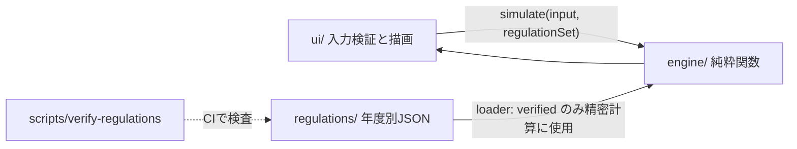

# DC Lens

選択制企業型確定拠出年金(選択制DC)とiDeCoを同じ条件で比較する、無料の公開シミュレータです。計算はすべてブラウザ内で完結し、入力値はサーバーへ送信も保存もされません。

個別の金融・税務・年金アドバイスではなく、将来の利回りを保証するものでもありません。

## 状態

基盤、制度データ(2026年度、協会けんぽ)、計算エンジンまで実装済みです。UIは未実装です。検証済みの制度データがない項目(協会けんぽ以外の健康保険者、拠出限度額など)は「未対応」として扱います。詳細は `CHANGELOG.md` と `docs/known-limitations.md` を参照してください。

## 構成



```text
src/
  engine/        計算(DOM非依存)
  regulations/   制度データのスキーマ、loader、年度別JSON
  ui/            フォーム、結果、SVGグラフ
tests/           unit / integration / e2e / fixtures(合成データのみ)
docs/            計算方法、出典、仮定、制限事項、設計
```

## 開発

```sh
pnpm install
pnpm dev                  # 開発サーバー
pnpm typecheck && pnpm lint && pnpm test && pnpm build
pnpm verify:regulations   # 制度データの検査
pnpm test:e2e             # Playwright
```

Node 22 以上と pnpm 12 を使います。pnpm が mise 経由で解決できない場合は `mise exec pnpm@12.11.2 -- pnpm <cmd>` を使ってください。

## 配信

`pnpm build` が `dist/` を生成し、Cloudflare Workers Static Assets が静的ファイルだけを配信します。サーバー側の処理、データベース、分析SDKはありません。

## ライセンス

MIT。制度データの出典と再配布条件は `docs/regulation-sources.md` に記録します。
